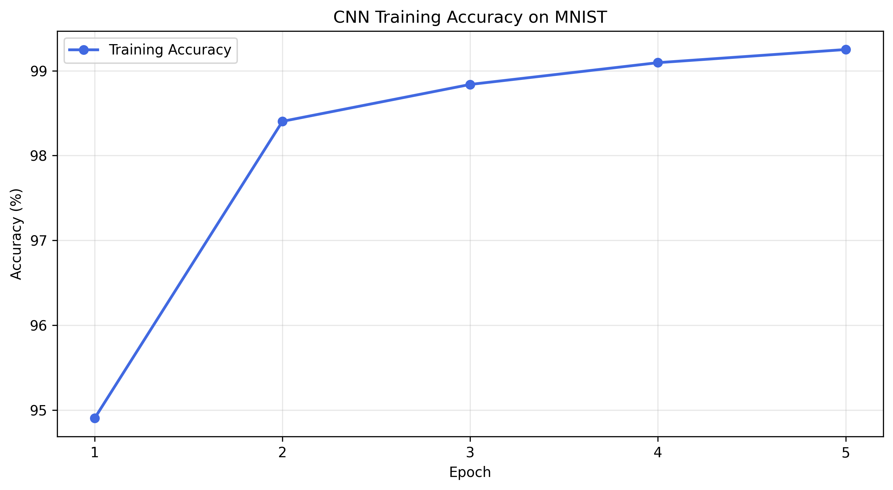
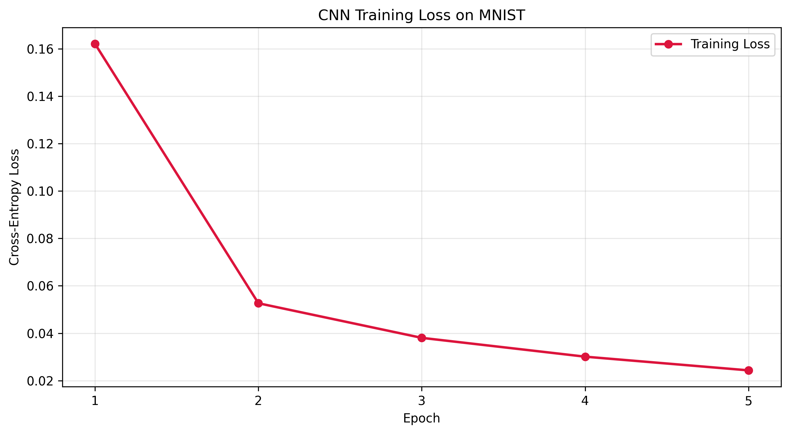
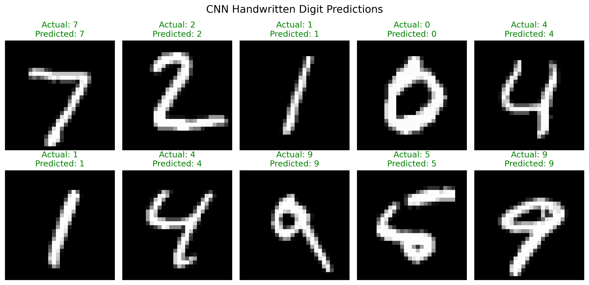
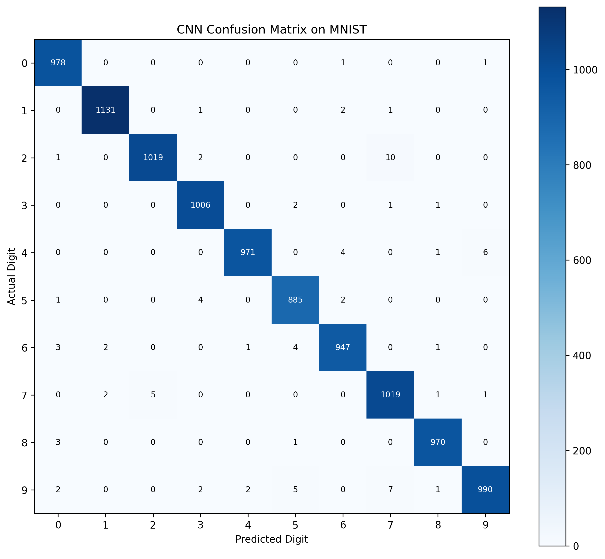

# Handwritten Digit Recognition Using CNN and PyTorch

A deep learning project that recognizes handwritten digits (0–9)
using a Convolutional Neural Network (CNN) trained on the MNIST dataset.

## Project Overview

- Framework: PyTorch
- Dataset: MNIST
- Training samples: 60,000
- Testing samples: 10,000
- Image size: 28 × 28 grayscale
- Classes: 10
- Architecture: Two convolutional layers with max pooling,
  followed by fully connected layers

## Model Performance

The initial trained model achieved:

- Training accuracy: 99.20%
- Test accuracy: 98.85%
- Training epochs: 5
- GPU acceleration: CUDA

Note: Results may vary when retraining.

## Results

### Training Accuracy


### Training Loss


### Digit Predictions


### Confusion Matrix


## Installation

Install dependencies:

```bash
pip install -r requirements.txt
```

## Run

```bash
python mnist_cnn.py
```

The script downloads MNIST automatically, trains the CNN,
evaluates performance, saves the trained model, and generates
visualizations in the results folder.

## Technologies

- Python
- PyTorch
- Torchvision
- NumPy
- Matplotlib

## Output Files

- `mnist_cnn.pth` — trained model weights
- `results/training_accuracy.png`
- `results/training_loss.png`
- `results/digit_predictions.png`
- `results/confusion_matrix.png`
- `results/training_history.csv`
- `results/test_results.txt`
